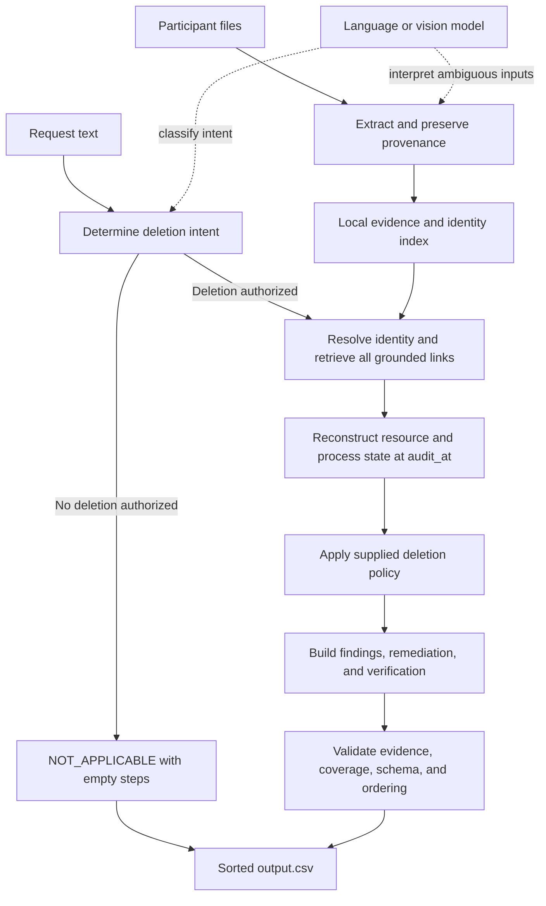

**Ghost Data Still Exists — Python foundation**

This document records the problem, the observed participant-data structure, and a proposed implementation. The dataset counts below were checked locally on 2026-10-25. This is the original architecture record; the implementation now exists. Consult README.md and the evaluation reports for current measured results and coverage assumptions.

**The problem in everyday terms**

A customer asks a company to delete their account and personal information. The company's dashboard may say the work is complete, while an old email, an attachment, a replica, or an export still contains their data. A synchronization job or a backup restore can also bring it back.

For each request, our program must establish what was true at the supplied `audit_at` time. It must determine whether deletion was authorized, identify the person across current and old identifiers, find the relevant records and processes, apply the supplied policy, and produce an evidence-backed verdict with the required steps.

The deliverable is an audit and a proposed remediation plan. Evidence snapshots are inputs to that investigation. The supplied deletion rules determine what should be deleted, retained, redacted, or anonymized.

An illustrative example: the primary account is absent, an index still contains the customer's old email, a connector can repopulate that index, and a security record must remain under the supplied retention policy. The deletion is incomplete. The plan must stop the connector, remove the index copy, preserve the required security record, and verify the resulting states. A claim that the primary account was deleted cannot establish the state of the other systems.

**What we must return**

| Verdict | Meaning | Required steps |
| --- | --- | --- |
| `NOT_APPLICABLE` | The request does not authorize deletion, such as an export, correction, or marketing opt-out request. | Exactly `[]`. |
| `COMPLETE` | All relevant data and processes meet the supplied policy at the cutoff. Required retained records remain available. | Only verification steps, each citing evidence of the compliant state. |
| `INCOMPLETE` | Evidence establishes a remaining policy violation or a process that can recreate prohibited data. | Findings, ordered remediation, and future verification. Findings cite evidence; remediation and future verification use an empty evidence ID. |

Write root-level `output.csv` with exactly `case_id,deletion_status,steps_json`, one row for each of the 518 evaluation cases, sorted by `case_id`. Every step has exactly seven fields:

```json
{
  "step_no": 1,
  "phase": "FINDING",
  "system_id": "search_service",
  "resource_id": "illustrative_search_record",
  "operation": "REPORT_REMAINING_RECORD",
  "state": "PRESENT",
  "evidence_id": "illustrative_file_id"
}
```

These illustrative IDs are not prediction values. Actual output must cite participant-visible `file_id`, `activity_id`, or `audit_id` values and grounded system and resource IDs.

Step numbers start at 1. Phases are `FINDING`, `REMEDIATION`, then `VERIFICATION`. The problem statement prescribes operation order within each phase, followed by ascending `system_id` and `resource_id`. The serializer must use that explicit order rather than alphabetical operation names. Allowed operation/state pairs come directly from `AGENTS.md` and `problem_statement.md`.

**What is actually in this checkout**

| Input | Observed size | Purpose |
| --- | ---: | --- |
| Evaluation requests | 518 | Cases requiring predictions. |
| Public sample requests and answers | 32 | Development and regression evaluation. |
| Current identity snapshots | 850 | Stable user IDs and identity fields, including unrelated people. |
| Identity-change audit events | 306 | Historical identifiers and their changes. |
| Global system activity | 4,011 | Operations, transfers, and links across resources and systems. |
| Deletion-policy rules | 15 | Required treatment and applicable conditions. |
| Manifest-listed evidence files | 94 | Paths, origin, capture time, and citation IDs. |

The evidence comprises 28 JSON files, 26 logs, 24 SQL snapshots, 11 PNG images, four PDFs, and one text file, totaling approximately 2.95 MB. All 94 manifest paths exist. This is small enough to extract once and search comprehensively with a local index.

The public sample answers contain 10 `COMPLETE` cases and 22 `INCOMPLETE` cases. They contain no `NOT_APPLICABLE` cases, making independent intent tests essential. There are 62 evaluation request texts containing non-ASCII characters; this is a character count, not a count of languages.

Representative structured files show several extraction challenges: JSON uses multiple nesting layouts; logs interleave requests and connect identifiers to resources through trace IDs; SQL snapshots distinguish primary and replica tables. File names and the manifest do not establish which cases a file belongs to.

**The core engineering problems**

1. **Deletion intent.** Understand the full request, including language, negation, and scope. A mention of deletion does not automatically authorize it. Preserve the request text and the reason for the internal intent decision.
2. **Identity resolution.** Link the supplied email to a stable user ID, current and historical emails, phones, hashes, and other grounded identifiers. Preserve original values alongside conservative normalized search forms. Names alone are weak links. Do not manufacture aliases or merge people merely because they look similar.
3. **Evidence discovery.** Search every supported format and follow grounded links from identifiers to resources, traces, and connected systems. A top-k semantic search can miss a single decisive copy; exact identifier and resource matching should be the starting point.
4. **Time reconstruction.** Separate when a fact describes the system from when the evidence was captured or became available. Reject evidence captured after the case cutoff even if it describes an older event. Do not project a later identity value backward without qualifying historical evidence.
5. **State versus claims.** An operation's reported success does not prove absence. A cache miss does not prove database absence. Link trace-start identifiers to trace-end resource observations. Preserve snapshot scope so an absent primary record cannot hide a present regional or failover replica.
6. **Policy application.** Keep required legal-hold and security records. Redact identifiers from shared support context when required. Anonymize attributable analytics. Preserve permitted tombstone user IDs while removing prohibited identifiers. A backup may remain when the applicable policy permits it and restore access is blocked.
7. **Recreation risks.** Model active synchronization, imports, and restores. Removing a current copy is insufficient when a relevant process can recreate it.
8. **Coverage and ordering.** Every conclusion must have appropriate support. Missing evidence is an internal coverage gap, not proof of absence. Generate the exact required output sequence and verification coverage.

**Approaches worth considering**

These are the main practical families of solutions. Several are complementary rather than mutually exclusive.

| Approach | Useful qualities | Main limitation | Proposed role |
| --- | --- | --- | --- |
| Deterministic parsing and rules | Reproducible, cheap, easy to inspect; strong for structured evidence. | Language and unfamiliar business artifacts need more interpretation. | Build first as the measurable baseline and core engine. |
| Model reads all evidence and writes an answer | Fast way to prototype reasoning. | Repeated context, uncertain retrieval coverage, invented IDs, and unstable ordering. | Limited experiments on public samples; measure against the baseline. |
| Retrieval-augmented generation | Sends smaller relevant evidence bundles to a model. | Semantic top-k retrieval can omit exact matches and historical aliases. | Add semantic retrieval for discovery; retain exhaustive identifier matching. |
| Hybrid extraction and deterministic decisions | Uses models for interpretation while code enforces identity, time, policy, and serialization. | Requires explicit interfaces and evidence schemas. | Recommended implementation. |
| Identity/resource graph plus event history | Makes alias chains, copy paths, replicas, and causal changes explicit. | Incorrect edges spread incorrect matches; unnecessary infrastructure can slow delivery. | Represent edges and time-qualified observations in Python/SQLite. |
| Specialist agents with a reviewer | Can split extraction, policy interpretation, and checking into separate roles. | Extra model cost, coordination, and inconsistent shared context. | Consider only after evaluation identifies a bottleneck. No agent delegation is needed to begin. |
| Fine-tuning or a learned status classifier | Could adapt repeated intent or extraction patterns with enough examples. | Only 32 public labeled cases; direct verdict learning can miss actual evidence. | Defer; never train or predict using hidden answers or case-number patterns. |

**Recommended Python design**



Extract each file once and cache by content hash, extractor version, and model configuration when applicable. Reuse extraction across all cases, but apply time and identity eligibility separately for each case. Cache keys for case reasoning must include the cutoff and relevant evidence versions.

Use standard parsers for CSV, JSON, text, logs, and SQL snapshots. Load each SQL snapshot into an isolated local SQLite database and inspect all relevant tables; preserve database topology and scope. For logs, group related lines by trace or correlation ID and retain the line references used to join them. Extract PDF text first. Use OCR or a vision model when images or scanned pages need it; retain page or image-region references and check uncertain identifier transcription.

Convert extraction into a common internal observation structure containing:

- source citation ID and exact source location;
- capture/availability time and observation/event time;
- system, resource, and replica or table scope;
- grounded subject identifiers and linking evidence;
- data category and observed fields;
- record or process state, retaining the raw supporting fact;
- extraction method and uncertainty.

Keep observations immutable. Resolve each case from a filtered view. Newer observations supersede older ones only when they refer to the same relevant resource and scope and establish a state change. Contradictions remain visible until resolved; do not settle them by majority vote among repeated claims.

Maintain an internal distinction among observed present, proven absent, redacted, anonymized, retained, active, disabled, blocked, and unresolved states. Only the allowed contract states go into submission steps. A source can establish presence without establishing absence across every copy. Identity-linking metadata must also be distinguished from personal fields actually stored in the audited record.

Compile the 15 policy rows into explicit evaluators, retaining their conditions. A category label alone is insufficient for conditional retention or redaction. Interpret ambiguous conditions with a model only when necessary, record the supporting evidence, and validate the result in code. An active restore path is a separate problem from the permitted retention of the backup artifact.

Build findings and the remediation dependency graph from those facts. Stop unsafe flows and restores before dependent record changes. Check downstream/source dependencies where evidence requires them. Serialize using the contract's canonical ordering. If a concrete dependency conflicts with the prescribed serialization, record the conflict for investigation rather than silently emitting an unexplained order.

The model returns schema-constrained extracted facts or interpretations with provenance. Code controls eligibility, policy mappings, allowed operations, citation validity, ordering, and CSV output. Use a provider adapter so model choice can be evaluated later. Model identifiers, calls, input/output tokens, retries, and costs must be recorded from the first experiment. Cached results must retain the usage metadata of the extraction run they depend on.

**Python tools and their roles**

| Component | Initial choice | Reason |
| --- | --- | --- |
| Runtime and terminal interface | Python; `argparse`, `pathlib`, `csv`, `json`, timezone-aware `datetime` | Small, portable command-line pipeline. |
| Local storage and exact lookups | `sqlite3`, with ordinary indexes; in-memory dictionaries where simpler | The observed corpus fits local storage. No separate database service is needed. |
| Typed boundaries | Pydantic with strict validation and forbidden extra fields | Validate extracted observations, model responses, and the exact step schema. |
| Native PDF text | `pypdf` | Extract text while retaining page references. It does not OCR image-only pages. |
| Image/scanned-page text | Tesseract OCR or a vision-model adapter | Recover visible facts; verify IDs and timestamps when extraction is uncertain. |
| State, identity links, and dependencies | Plain Python structures and SQLite tables | Explicit, inspectable logic without an orchestration framework dependency. |
| Verification | Standard-library `unittest` plus a sample evaluator | Test temporal, identity, policy, and output behavior. |
| Model integration | Small provider-specific adapter behind a common interface | Change model/provider without rewriting the audit engine; log actual usage. |

Pin third-party dependencies when implementation begins and verify them in the chosen runtime. The foundation does not require a vector database, a web application, or a graph-database service. Add components only when measured errors or runtime justify them.

The package capabilities above were checked against primary documentation: [Python SQLite](https://docs.python.org/3/library/sqlite3.html), [Pydantic validation](https://docs.pydantic.dev/latest/), [pypdf text extraction and OCR limitations](https://pypdf.readthedocs.io/en/stable/user/extract-text.html), and [Tesseract](https://tesseract-ocr.github.io/tessdoc/). Our choice of architecture is an engineering recommendation based on the local corpus.

**Proposed module boundaries**

```text
code/
  main.py                 # CLI and pipeline orchestration
  audit/
    models.py             # Requests, observations, internal decisions, output steps
    ingestion.py          # Dataset loading, extraction registry, manifest checks
    extractors/           # CSV, JSON, logs, SQL, PDF, image adapters
    identity.py           # Grounded current/historical identity links
    retrieval.py          # Identifier, resource, trace, and dependency lookup
    timeline.py           # Evidence eligibility and scoped state reconstruction
    policy.py             # Conditional treatment and retention decisions
    planner.py            # Findings, dependencies, remediation, verification
    validation.py         # Evidence, time, coverage, ordering, and schema checks
    export.py             # Deterministic root output.csv
    llm.py                # Intent/extraction adapter, cache, token and cost accounting
  evaluation/
    main.py               # Public sample and custom-case evaluator
    evaluation_report.md  # Metrics, custom scenarios, failures, improvements
    usage_report.md       # Actual final-run usage and cost accounting
  tests/                  # Independent behavioral regression cases
```

This layout is proposed. The two existing `main.py` starter files are empty. Implementation should preserve the repository's terminal execution and packaging contract.

**Build and evaluate in stages**

1. **Establish contracts.** Define typed input/output objects, allowed operation/state pairs, canonical ordering, and strict validators. Add an inventory command and a documented run command. Count actual input rows and check against the expected 518-case contract rather than inventing case IDs.
2. **Extract structured evidence.** Support every observed JSON layout, trace-linked logs, text, and SQL topology. Track manifest coverage, parse failures, source locations, and observation times. Make unsupported or failed extraction visible.
3. **Resolve identities and time.** Add alias intervals, conservative matching, exact resource links, case-specific cutoff filters, and scoped state reconstruction. Test recreation after a prior deletion and exclude later evidence.
4. **Apply policy and plan.** Implement conditional rules, tombstone field checks, retention, active flows, restore blocks, findings, and required future checks. Add the deterministic serializer.
5. **Add language and visual interpretation.** Introduce deletion-intent classification and PDF/image extraction through narrow adapters. Use the model for unresolved interpretation with explicit evidence; never manufacture missing IDs or proof.
6. **Measure and improve.** Evaluate all 32 public cases end to end. Compare case status, matched steps, individual fields, and exact ordered sequences. Record both precision and recall for findings so a correct status cannot hide missed records. Track source extraction coverage and citation/time validity separately from answer accuracy.
7. **Run and package.** Produce the 518-row file, record actual model usage including preprocessing attributable to the final run, write both required Markdown reports, and package runnable source with setup instructions. Do not include the dataset, secrets, caches, or nested archives in `code.zip`.

Use sample answers only to evaluate or develop general behavior. Keep them out of the prediction path. Hidden evaluation answers are unavailable, so full-dataset accuracy must not be claimed from schema checks or public-sample accuracy. During development, separate tuning examples from regression examples where practical and report that distinction.

Create independent scenarios covering at least: an export or opt-out request with `NOT_APPLICABLE`; an old email found in a downstream copy; evidence captured after the cutoff; a primary deletion with a remaining replica; a compliant tombstone with a stable user ID; an identifiable tombstone; a retained legal/security record; interleaved log traces; and a disabled or active recreation path. Use small, fictional fixtures with expected behavior derived from the policy. These scenarios address real behavior rather than mirroring parser implementation details.

Before allowing a `COMPLETE` decision, require evidence of the relevant compliant record and process states. If retrieval or extraction is unresolved, keep an internal unresolved result and perform the remaining investigation. Do not convert uncertainty into a fabricated finding or an unsupported `COMPLETE` verdict. A development run should fail visibly when it cannot produce a supported answer.

The initial milestone is a Python pipeline that explains each public sample through inspectable facts, passes independent identity/time/policy tests, and emits valid ordered steps. Then broaden evidence coverage and measure the full run. No production audit, prediction output, or performance claim is created by this foundation document.
